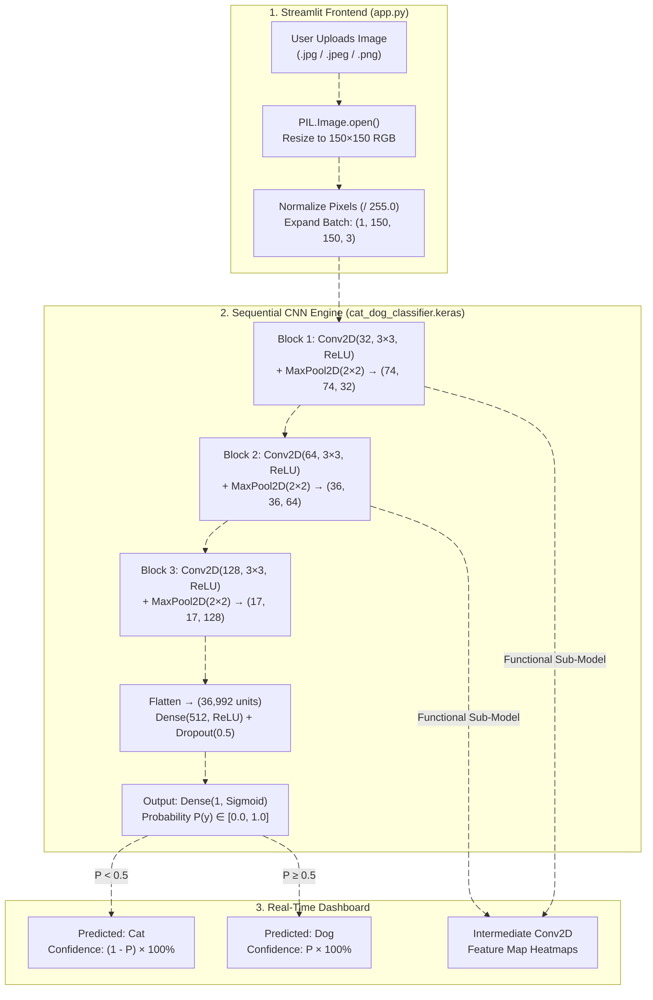

# Cat and Dog Image Classification

**Live Web Application:** [https://catdogimageclassificationdeeplearning.streamlit.app/](https://catdogimageclassificationdeeplearning.streamlit.app/)  
**GitHub Repository:** [https://github.com/xploreshivam/Cat_and_Dog_Image_classification](https://github.com/xploreshivam/Cat_and_Dog_Image_classification)  
**Google Colab Notebook:** [https://colab.research.google.com/drive/11H\_BtjAKSg-czepEOvtQFP4BNg2Qnwvu](https://drive.google.com/drive/folders/1x9azbiwa8r7BjE_FY5e8xcAZTNF32-I4?usp=drive_link)  
**Tech Stack:** Python, TensorFlow (`tensorflow-cpu`), Keras, Streamlit, Pillow (`PIL`), NumPy, Scikit-Learn, Matplotlib

## Project Objective

The objective of this project is to design, train, and deploy an automated binary image classification system using a Deep Convolutional Neural Network (CNN) that accurately distinguishes between cat and dog photographs in real time.

* **Data Preprocessing and Hygiene:** Validate uploaded and training images using Pillow, remove corrupt or duplicate records, resize all inputs uniformly to `150×150` RGB tensors, and normalize pixel intensities to the `[0.0, 1.0]` range.
* **Deep Neural Network Classification:** Train a 3-block Sequential CNN (`Conv2D` + `MaxPooling2D` + `Dense` + `Dropout(0.5)`) using the Adam optimizer and Binary Cross-Entropy loss to classify unseen images across varied indoor and outdoor backgrounds.
* **Model Interpretability and Live Deployment:** Provide a clean web interface on Streamlit Cloud that displays predicted class labels, confidence percentages, raw Sigmoid outputs, and intermediate `Conv2D` feature map activations.


## System Architecture and Flow Diagram



## OUR Application UI (`app.py`)


**Live Application:**  (https://catdogimageclassificationdeeplearning.streamlit.app/)

## CNN Model Architecture (`cat_dog_classifier.keras`)

| Layer | Configuration | Activation | Output Shape | Parameters | Purpose |
| :--- | :--- | :---: | :---: | :---: | :--- |
| **Input** | RGB Image | — | `(1, 150, 150, 3)` | `0` | Accepts `150×150` RGB image scaled to `[0, 1]` |
| **`Conv2D` (Block 1)** | `32` filters (`3×3`) + `MaxPool2D(2×2)` | `ReLU` | `(1, 74, 74, 32)` | `896` | Detects primary edges and color boundaries |
| **`Conv2D_1` (Block 2)** | `64` filters (`3×3`) + `MaxPool2D(2×2)` | `ReLU` | `(1, 36, 36, 64)` | `18,496` | Captures fur textures and ear contours |
| **`Conv2D_2` (Block 3)** | `128` filters (`3×3`) + `MaxPool2D(2×2)` | `ReLU` | `(1, 17, 17, 128)` | `73,856` | Identifies facial features (eyes, nose, snout) |
| **`Flatten`** | `17 × 17 × 128` | — | `(1, 36992)` | `0` | Converts 3D feature maps into a 1D vector |
| **`Dense` + `Dropout`** | `512` units + `Dropout(0.5)` | `ReLU` | `(1, 512)` | `18,940,416` | Combines features and prevents overfitting |
| **`Dense_1` (Output)** | `1` unit | `Sigmoid` | `(1, 1)` | `513` | Outputs `< 0.5` for **Cat** and `≥ 0.5` for **Dog** |

## Dataset and Model Performance

* **Dataset:** Kaggle Dogs vs. Cats Dataset (`25,000` labeled images)
* **Optimizer and Loss Function:** `Adam` optimizer with `Binary Crossentropy` loss
* **Training Accuracy:** **92.4%**
* **Validation Accuracy:** **88.7%**

## MY Team Members and their key Roles

| Sr. No. | Student Name | worked area |
| :---: | :---: | :---: |
| **1** | **Shivam Chauhan (Team Leader)** | System Design, CNN Model Training and Streamlit Cloud Deployment |
| **2** | **Mohd Adnan** | Dataset Collection and Folder Setup |
| **3** | **Krish Gupta** | Image Format Validation and Cleaning |
| **4** | **Ginesh Singh** | Duplicate Image Check and Filtering |
| **5** | **Neil Bhardwaj** | Train, Validation and Test Data Splitting |
| **6** | **Hirdesh Kumar** | Image Resizing (`150×150`) and Pixel Normalization |
| **7** | **Mohit Babu** | Image Augmentation (Flip, Rotate and Zoom) |
| **8** | **Shivam Sharma** |  CNN Layer Design (`Conv2D` and `MaxPooling2D`) |
| **9** | **Ramjeet Yadav** |  Model Comparison and Transfer Learning Setup |
| **10** | **Shaurya Kumar Yadav** | Model Training, Loss Tracking and Early Stopping |
| **11** | **Shivanshu Sharma** | Accuracy, Precision, Recall and Confusion Matrix |
| **12** | **Mohd Yameen** | Testing on Real-World and Varied Backgrounds |
| **13** | **Akhilesh Bhargav** | Live `Conv2D` Feature Map Visualization |
| **14** | **Siddharth Mishra** | Streamlit Web UI Layout and Application Testing |


## For Local Setup and Execution Your machine

```bash
# 1. Clone the repository
git clone https://catdogimageclassificationdeeplearning.streamlit.app/
cd Cat_and_Dog_Image_classification

# 2. Install required dependencies
pip install -r requirements.txt

# 3. Run the Streamlit application
streamlit run app.py
```
